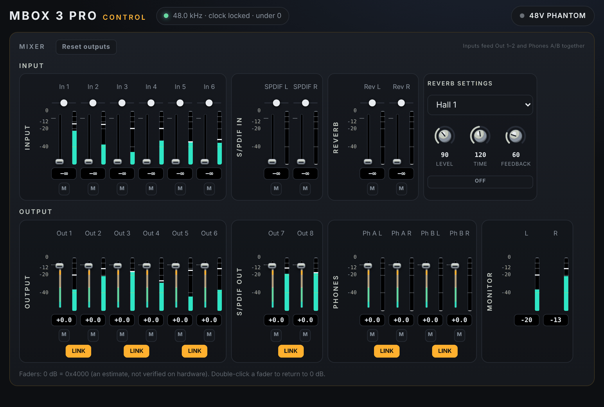

# Mbox3pro-Ventura-intelmac

An unofficial macOS driver for the **Avid Mbox 3 Pro** (FireWire, TCAT DICE), written for macOS 13 Ventura on Intel,
where Apple removed its FireWire audio support.

> **Apple Silicon (beta, untested).** Since v0.3.0-beta.1 the package is universal (Intel + Apple Silicon). The Intel part is the tested one
> (MacBook Air 2017). The Apple Silicon part builds the same code for arm64 but **has never been run on an Apple Silicon Mac**: it may not
> work at all. Apple Silicon Macs have no FireWire port, so you need Thunderbolt adapters (Thunderbolt 3 to Thunderbolt 2, then Thunderbolt 2 to
> FireWire), and the macOS you use must still have Apple's FireWire stack: **macOS 13 to 15**. On **macOS 26 (Tahoe)** Apple removed the FireWire
> stack, so this driver cannot work there; use [ASFireWire](https://www.asfw.net/) (a separate, open-source project) instead.
> **Testers are very welcome**, see [Testing on Apple Silicon](#testing-on-apple-silicon-beta).

It makes the interface show up as a normal CoreAudio device and adds a small browser-based control panel for the
mixer, routing and reverb.

> **Status: experimental.** It has been developed and tested on exactly one setup (see [Tested on](#tested-on)).
> It talks to the hardware by writing device registers. Use it at your own risk (see [Disclaimer](#disclaimer)).

## What works

- 8 in / 8 out audio at **44.1, 48, 88.2 and 96 kHz** (analog 1-6 and S/PDIF), switchable from Audio MIDI Setup.
  The daemon restarts the stream at the new rate in about 3 seconds. All four rates are verified on hardware
  (see [DESIGN.md](DESIGN.md) section 30); 176.4 / 192 kHz are not supported.
- Clock-locked full duplex streaming, tested with Pro Tools and with system audio / a browser.
- Small buffers: 64, 128 and 256 frames were tested without distortion in Pro Tools; 512 frames is the default of
  system audio. See [DESIGN.md](DESIGN.md) section 27 for how the 128-frame problem was solved.
- Low latency by default: about 17 ms of output latency in the driver and device (plus your DAW's buffer), tunable with `scripts/tune.sh`. The old, more cautious setting (about 46 ms) is `scripts/tune.sh 768 512 224`.
- A control panel at `http://127.0.0.1:47310/`:
  - output volumes (Out 1-8, headphones A/B) with stereo link,
  - input / S/PDIF / reverb-return faders with pan and mute (fed to Out 1-2 and both headphone outputs),
  - reverb type and parameters, and a reverb ON/OFF switch (off by default on the first visit),
  - 48 V phantom power with a confirmation dialog,
  - peak meters.
- The last mixer and reverb state is saved and restored automatically at every start of streaming.

## What does not work (yet)

- 176.4 / 192 kHz, ADAT, MIDI.
- External clock sources (S/PDIF, word clock).
- Hot-plug is handled by polling: if the audio stops (cable or power removed), the daemon logs `no device ... waiting`, retries every 2 s and resumes streaming when the device is back (`device found again`). Checked on hardware: unplugging during playback, power cycling, and plugging back in at a different sample rate.
- While the daemon is running the host owns the device and the firmware's standalone routing is off.
  To get standalone mode back, uninstall (or stop the daemon) and **power-cycle the Mbox 3 Pro**.
- The hardware knob / DIM / mute state is shown by the firmware only; the panel does not control it.
- Right after the daemon starts (boot, install, restart), the first start often fails with `clock did not lock` in the log and works on the retry
  a few seconds later. This is expected (see [DESIGN.md](DESIGN.md) section 31).
- Only the Mbox 3 Pro has been tried. Other DICE devices will not work without changes.
- The XPC peer check is by user ID only (root and `_coreaudiod`), not by code signature.

## Requirements

- macOS 13 Ventura on Intel: tested. Apple Silicon (macOS 13 to 15): beta, untested. macOS 12 Monterey and older (Intel): the package is built for macOS 12 and later, but nothing
  has been tried there; another driver (Apple's own, or Avid's) may hold the device first. The FireWire stack (IOFireWireFamily) is gone in macOS 26.
- Xcode Command Line Tools (`xcode-select --install`) for `cc`, `make` and `codesign`.
- A working FireWire connection to the Mbox 3 Pro (FireWire 400 port, or a Thunderbolt-to-FireWire adapter chain).

## Install from a package (easiest)

Download `Mbox3pro-Ventura-intelmac-<version>.pkg` from the [Releases page](https://github.com/mackie1985/Mbox3pro-Ventura-intelmac/releases) and open it. The installer puts the plug-in, the daemon and the
control panel in place, starts the daemon and restarts the sound system (quit your audio apps first). The package is **not signed or
notarised**, so macOS refuses a double-click on a downloaded copy: right-click it and choose **Open**, or use
System Settings > Privacy & Security > **Open Anyway**. In a terminal it also works without that:

```sh
sudo installer -pkg Mbox3pro-Ventura-intelmac-<version>.pkg -target /
```

To remove it: `sudo /usr/local/share/mbox3pro/uninstall.sh`, then power-cycle the Mbox 3 Pro.

To build the package yourself (on any Mac with the command line tools; the package is universal, Intel + Apple Silicon beta):

```sh
make pkg                        # -> build/Mbox3pro-Ventura-intelmac-<version>.pkg
```

## Build and install from the sources

```sh
make daemon driver shmcheck
scripts/install.sh all          # asks for your password (sudo)
```

`install.sh` installs

| what | where |
|---|---|
| daemon `mbox3d` | `/usr/local/libexec/mbox3d`, LaunchDaemon `com.mbox3pro.driver.daemon` |
| control panel page | `/usr/local/share/mbox3pro/ui/index.html` |
| Audio Server plug-in | `/Library/Audio/Plug-Ins/HAL/Mbox3.driver` (ad-hoc signed) |

and restarts `coreaudiod`. Restart the audio applications afterwards. Open `http://127.0.0.1:47310/`.

Always rebuild (`make ...`) before `install.sh` after unpacking a new copy of the sources, and always install the
daemon and the plug-in **together** (`install.sh all`): they share a memory layout that is versioned
(`M3_VERSION` in `driver/proto.h`), and mixed versions produce silence.

Uninstall:

```sh
scripts/uninstall.sh
```

Then power-cycle the interface to restore its standalone routing. Saved state files
(`/var/db/mbox3d-last.state`, `/var/db/mbox3d.rate*`, `/var/db/mbox3d.conf`) are kept; delete them by hand if you want.

## Using it

Choose **Mbox 3 Pro** as the output / input device in System Settings or in your DAW. Logs are in `/var/log/mbox3d.log`.



The control panel (open `http://127.0.0.1:47310/` in a browser on the same Mac): mixer, level meters, reverb settings, 48 V phantom power.

The control panel language follows the browser (English, or Japanese when the browser language is Japanese).

## Troubleshooting

Check the data path with the included tool (it needs no sudo):

```sh
sudo build/m3_shm_check watch 10    # needs root: the daemon only accepts root and coreaudiod
```

The lines to look at: `under`, `late`, `dbc` (should stay at 0 once running), `playback peak` (should follow
`CoreAudio output peak` while something plays), and `write margin min` (should stay positive).

- **`no FireWire device found` forever, and `system_profiler SPFireWireDataType` prints nothing**: the Mac itself does not see the FireWire controller in the
  adapter (the Thunderbolt link can still be fine: check `system_profiler SPThunderboltDataType`). Restarting the daemon does not help. Restart the Mac with the adapter
  plugged in; if that is not enough, shut down, unplug the adapters, wait 30 seconds, plug them in, and start the Mac. This was seen once and a restart fixed it.
- **Silence after an upgrade**: you probably replaced only one of the daemon and the plug-in. Run `scripts/install.sh all`
  and restart the audio application.
- **`start failed: clock did not lock` in the log, or silence with pops**: stop the daemon
  (`sudo launchctl bootout system/com.mbox3pro.driver.daemon`), power-cycle the interface, reinstall with
  `scripts/install.sh all`. To test the device without CoreAudio (daemon stopped): `make demo && build/mbox3_demo tone 6 440`.
- **`Open failed: 0xe00002c5`** (exclusive access): another process, usually the daemon, still holds the device. Killing
  the process is not enough because launchd restarts it; use `launchctl bootout` as above.
- **88.2 / 96 kHz problems**: stop the daemon (`sudo launchctl bootout system/com.mbox3pro.driver.daemon`) and test the device directly:
  `make demo && build/mbox3_demo tone 6 440 rate=96000`, then reinstall with `scripts/install.sh all`. Please report the
  `router` and `rx:` lines of `/var/log/mbox3d.log` together with the result.
- Latency / dropout tuning: `scripts/tune.sh [PREFILL QUEUE [AHEAD]]` (no arguments restores the defaults, 384 320 64). If you hear crackles on playback, try `scripts/tune.sh 512 384 96` or the cautious `768 512 224`.
- Monitoring through the DAW (input monitoring of a record-armed track) may crackle in Pro Tools even when recordings are clean; use the control panel mixer for direct monitoring.
  More background is in [DESIGN.md](DESIGN.md) sections 12-15.

## Architecture in short

```
CoreAudio (coreaudiod)
  └─ Mbox3.driver  (Audio Server plug-in)   float32 <-> 24 bit, time base, drift handling
        │  XPC (mach service) + shared memory rings
  mbox3d  (LaunchDaemon, root)              owns the device, runs the isochronous streams, hosts the control panel
        │  libmbox3
  IOFireWireLib  ->  Mbox 3 Pro  (TCAT DICE)
```

- `lib/` libmbox3: DICE register access, isochronous (IEC 61883-6 / AM824) receive and transmit, clock handling.
- `daemon/` the LaunchDaemon and the control-panel HTTP server.
- `driver/` the Audio Server plug-in and the shared-memory protocol (`proto.h`).
- `src/` platform-independent protocol parts (application section, DICE helpers) with unit tests in `tests/`.
- `tools/` investigation tools (`dice_probe`, `dice_ctl`, `mbox3_demo`, `m3_shm_check`) and a mock server for UI work.
- `ui/` the single-file control panel.

The unit tests of the platform-independent part run on any host: `make test`.

[DESIGN.md](DESIGN.md) is the full engineering log: register map findings, how the streams were brought up,
and the measured problems and fixes. A Japanese version is in [DESIGN.ja.md](DESIGN.ja.md).

## Security notes

- The control panel listens on `127.0.0.1` only, checks the `Host` header and requires a custom header on every POST.
  The panel can switch on 48 V phantom power; the page asks for confirmation first.
- The daemon accepts XPC connections only from root and the `_coreaudiod` user (the one coreaudiod and its plug-ins run as). Any other process is refused
  (log: `refused an XPC connection from uid ...`), so an ordinary user process cannot read the device's input audio or play through the device.
  It does not check the code signature of the peer.
- The daemon runs as root. The plug-in is ad-hoc signed, not notarised.

## Tested on

- Avid Mbox 3 Pro, firmware as shipped, FireWire 400.
- MacBook Air (13-inch, 2017), running macOS 13 Ventura via OpenCore Legacy Patcher (OCLP), at 44.1, 48, 88.2 and 96 kHz.
- Pro Tools, and system audio (browser, `afplay`).

That is one machine and one interface, so **testing on other setups is very welcome**: other Intel Macs, Apple Silicon Macs (beta), other macOS versions,
other FireWire adapters or a second Mbox 3 Pro, long sessions, other DAWs. Whether it works or not, please [open an issue](https://github.com/mackie1985/Mbox3pro-Ventura-intelmac/issues) and include
`sudo build/m3_shm_check watch 10` output and `/var/log/mbox3d.log`, the Mac model, the macOS version and how the Mac is connected to the Mbox
(a native FireWire port, or an adapter chain).

## Testing on Apple Silicon (beta)

If you have an Apple Silicon Mac **running macOS 13 to 15** (not 26: see the note at the top), a Mbox 3 Pro and the Thunderbolt-to-FireWire adapters, please try the package and tell me what happens, **also when
it does not work**. Step by step, stopping at the first step that fails:

1. Does macOS see the FireWire device? `system_profiler SPFireWireDataType` should list the Mbox 3 Pro. If it does not, the problem is below this driver (adapters, cables, macOS).
2. After installing the package: `file /usr/local/libexec/mbox3d` should say `Mach-O universal binary with 2 architectures`, and `tail -n 40 /var/log/mbox3d.log` should show `streaming at 44100 Hz`.
3. Is "Mbox 3 Pro" in System Settings > Sound? Does sound play, and does recording work?
4. After a few minutes of playback: `grep "rates over" /var/log/mbox3d.log | tail -n 3`.

Please [open an issue](https://github.com/mackie1985/Mbox3pro-Ventura-intelmac/issues) with the Mac model, the macOS version, the adapters, `/var/log/mbox3d.log`
and the output of the commands above. Known unknowns: memory ordering on arm64 (memory barriers were added but not tried), 16 KB pages, and whether FireWire works
on your macOS version at all.

## Testing on older macOS (Intel)

The package is built for macOS 12 Monterey and later. If you run Monterey, please try it and report, also when it fails. Check first that no other driver holds the Mbox
(Avid's or Apple's: `ioreg -l | grep -i -E "AppleFWAudio|Mbox"`). Please [open an issue](https://github.com/mackie1985/Mbox3pro-Ventura-intelmac/issues) with the macOS version and `/var/log/mbox3d.log`.

## Disclaimer

This is an independent project and is **not affiliated with, endorsed by or supported by Avid Technology**.
"Avid", "Mbox" and "Pro Tools" are trademarks of their respective owners; they are used here only to say what the
software works with.

The driver writes to the registers of the audio interface and to the audio server of your computer. It is provided
**without any warranty** (see the license). Check what is connected before using 48 V phantom power: ribbon
microphones and unbalanced equipment can be damaged. Turn the monitor level down when you first try it.

## Credits and license

The protocol knowledge builds on the reverse-engineering work of the Linux `snd-dice` driver and the
`firewire-dice-protocols` project (LGPL-3.0-or-later).

Copyright (C) 2026 Mackie.

Licensed under the **GNU Lesser General Public License, version 3 or later** (`LGPL-3.0-or-later`).
The full text of the LGPL-3.0 is in [LICENSE](LICENSE). The LGPL-3.0 supplements the GNU GPL version 3,
whose full text is in [COPYING](COPYING).
